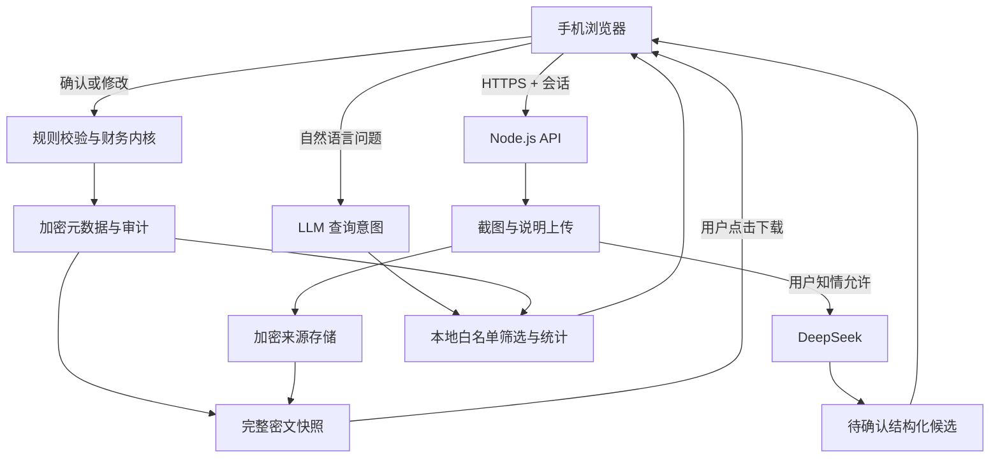

# 蓝鲸账本技术设计

> 版本：0.3.0 · 日期：2026-11-14  
> 状态：已实现第一版（代码与自动化测试见 `apps/`、`tests/`）。本文描述目标行为。  
> 项目目录：`/home/wurong/orca/projects/vault-ledger`  
> 配套文档：[实施文档](./实施文档.md)

## 1. 产品与需求基线

蓝鲸账本是一个程序开源、数据私有的个人账单管理项目。运行于 Ubuntu 24，手机通过浏览器使用。用户上传完整账单截图并添加说明，DeepSeek 将内容转换为可编辑的结构化记录；用户确认后加密保存。系统支持自然语言查询、借还款记录、账本切换，以及下载和恢复完整加密备份。

### 1.1 已确认的需求

| 编号 | 需求 | 第一版目标 |
|---|---|---|
| R01 | 个人项目，程序开源 | 代码仓库只包含代码、示例配置和虚构测试数据 |
| R02 | 手机优先 | 浏览器上传截图、填写说明、查看记录、查询与备份 |
| R03 | 截图与说明一起录入 | 保存原始截图、用户说明、提取结果及确认后的结构化数据 |
| R04 | 显示完整账单 | 上传预览和历史记录均能打开完整原图，支持缩放及长图滚动 |
| R05 | LLM 优先 DeepSeek | 图片识别、文字提取、自然语言查询；保留适配层 |
| R06 | 允许云端模型处理数据 | 明确展示截图、说明及问题会发送到配置的模型服务 |
| R07 | 数据加密，凭密码查看 | 真实数据和界面录入的 API Key 均加密落盘，浏览数据须解锁 |
| R08 | 借还款结构化 | 记录谁、借入/借出/归还/收回、金额、方式、时间和备注 |
| R09 | LLM 可查询账目 | 问题转查询条件，本地程序筛选、计算、返回可核对记录 |
| R10 | 多账单切换 | 同时提供多张来源截图浏览；账本层支持个人、家庭等独立分组 |
| R11 | 手机一次下载是一份备份 | 下载当时全部账本、记录、截图和必要设置的完整加密快照 |
| R12 | 上传备份恢复 | 验证备份密码及完整性后恢复，保护恢复前的本地数据 |
| R13 | 缺配置时引导 | 首次设置密码、填写/测试 DeepSeek Key、创建首个账本 |
| R14 | 支持环境变量配置 | 普通配置可明文；密钥不公开、不进入 Git；环境变量优先于界面设置 |
| R15 | Node.js 技术栈 | 前后端使用 TypeScript，不再沿用 Python/FastAPI 方案 |

R10 中“多账单”曾出现术语歧义。此版本同时覆盖多来源图片查看与独立账本切换，避免让来源图片和账本共用一个概念。账本用于分组，不表示多人权限隔离。

### 1.2 第一版不做

- Git 自动提交或 push、定时异地备份、电脑间自动同步。
- 银行抓取、自动转账、多人协作、企业财务与税务。
- CSV/PDF 批量导入、自动对账、整月流水长图的全自动批量入账。
- 多币种换算、加密资产估值、利息与复杂分期。
- 离线保存敏感账目、原生手机 App、服务器管理员不可见的端到端加密。
- LLM 直接入账、直接修改记录、生成并执行任意 SQL。

后续如需异地备份，可对接 Git、SFTP/restic 或对象存储，第一版的数据格式不绑定具体备份目的地。

## 2. 用户路径和页面

### 2.1 首次配置引导

```text
打开应用
  ├─ 没有数据 → 新建 / 从备份恢复
  │                ├─ 新建：设置并确认密码 → 配置 DeepSeek → 创建账本 → 首页
  │                └─ 恢复：选择备份 → 输入备份密码 → 验证和预览 → 确认恢复
  └─ 已有数据 → 输入密码解锁 → 首页 / 缺失配置补全
```

- 新建密码至少 6 个字符，允许较长口令，显示可切换的密码可见按钮。
- 密码尝试有冷却阶梯：前 3 次输错不冷却；第 4 次失败后进入 1 分钟冷却，之后每次失败逐级拉长为 1 小时 → 1 天 → 1 周 → 1 月 → 1 年。冷却期内即使密码正确也拒绝，直至到期。计数只存在于内存，重启服务即重置。
- 明确提示：密码不上传 DeepSeek；密码遗失时本项目不提供找回能力。
- DeepSeek 页面提供 API Key 输入、模型名称、测试连接、返回/继续操作。
- Key 只显示掩码与配置来源，保存后不回显完整值。
- 测试连接使用固定的非财务测试消息，不发送账本、截图或真实交易。
- 环境变量已提供 Key 时，显示“已通过环境变量配置”，允许测试，避免要求重复填写。
- 模型未配置成功时可进入账本，保留手动录入、浏览、备份与恢复；识别和 AI 查询入口显示配置引导。
- 引导流程支持中途退出：已创建的加密数据保留，下次解锁后继续缺失步骤，不能静默覆盖。
- 首次配置入口仅在未初始化时可用；首次部署应在可信本机访问完成初始化后，再开放手机访问。

### 2.2 截图录入

1. 选择目标账本。
2. 从手机相册选择一张截图；相机照片也可使用。
3. 显示完整预览，用户可放大检查；添加说明，例如“微信借给张三 500，月底还”。
4. 点击“识别”，明确显示截图和说明将发送到 DeepSeek。
5. 展示可编辑的结构化候选，缺失或不确定字段标注“待确认”。
6. 用户修改并确认，服务端重新校验、检查重复、保存来源与正式记录。
7. 显示“已保存到本机；尚未下载最新备份”，可立即查看原图或继续录入。

一次上传是一份来源。第一版自动提取一笔明确交易；一张图片包含多笔或多页时提示人工选择，允许同一来源下手动补充多笔记录。不能把整张账单擅自合计成一笔交易。

相同截图再次上传时复用或提示已有来源；不能仅凭同日同金额禁止真实的第二笔消费。用户可以在同一来源下确认不同记录，但同一个确认请求重复发送不得重复入账。

### 2.3 记录与修改

- 首页：当前账本、日常收支摘要、借还款摘要、最近记录、备份提醒。
- 流水：按日期、类型、分类、对方、支付方式、关键词筛选。
- 详情：展示全部结构化字段、原始说明、完整截图、识别结果与修改历史。
- 修改：用户直接编辑，保存后新增修订版本，旧版本和金额调整历史保留。
- 删除：第一版采用作废，保留来源和审计，不把历史物理抹掉。
- 原图查看页不裁切账单内容；列表缩略图可裁切，须能进入完整原图。

### 2.4 借还款

| 类型 | 用户示例 | 账务含义 |
|---|---|---|
| 借出 `lend` | 我微信借给张三 500 | 应收本金增加，不算日常支出 |
| 借入 `borrow` | 我向李四借了 800 | 应付本金增加，不算日常收入 |
| 收回 `repayment_received` | 张三还我 200 | 应收本金减少，不算日常收入 |
| 归还 `repayment_paid` | 我还李四 300 | 应付本金减少，不算日常支出 |

按账本、联系人和币种分别计算：

```text
对方还欠我 = 累计借出 − 累计收回
我还欠对方 = 累计借入 − 累计归还
```

联系人使用稳定 ID；模型识别的姓名只是建议，确认时可选已有联系人或新建。同名人允许区分，不自动合并。首版统计本金，不含利息；允许部分还款。不完整的历史可能产生负余额，应展示“多收/多还或缺少历史”，不能截断为零或伪装为已结清。

第一版按人汇总，不强制逐笔核销借款。备注可记录约定，后续再增加借款合同和还款对应关系。

### 2.5 AI 查询

示例：“本月餐饮花了多少”“张三还欠我多少”“我通过微信还过李四多少钱”“找出上周的打车记录”。

1. 用户输入问题，明确查询范围为当前账本。
2. 模型仅返回受约束的查询意图。
3. 服务端验证筛选条件和允许的统计方式。
4. 本地程序筛选记录，执行精确金额运算。
5. 展示查询条件、笔数、分项金额、借还款余额及来源记录。

模型不负责计算最终金额。第一版不做任意报表生成或开放式财务建议。当前欠款查询按全部有效历史计算；带日期的借还款结果应标为“该期间净变动”，不能冒充当前欠款。UI 必须显示实际应用的筛选条件，方便用户发现模型理解偏差。

### 2.6 多账本与来源切换

- 一个加密数据空间、一个解锁密码，下含多个账本。
- 账本拥有独立的记录、联系人、分类和默认账户。
- 切换后清空旧账本的列表、查询结果及未确认表单，防止误入账。
- 识别任务绑定提交时的账本；切换后任务结果只返回原账本，不写进新账本。
- 来源列表支持查看多张已上传图片；来源可关联多笔记录。
- 默认只查询当前账本；跨账本统计留待后续。
- 下载备份默认包含所有账本，无需逐个备份。

### 2.7 下载备份与恢复

下载按钮文案：“下载加密备份”。每次点击生成当时的一份完整快照，文件名例如：

```text
LedgerBox-20261114-213000-r42.ledgerbox
```

- 包含全部账本、记录、来源原图、备注、修订、审计，以及加密保存的应用设置（含界面录入的 DeepSeek Key）。
- 不包含登录会话、操作系统配置、环境变量值或环境变量提供的 Key。
- 备份始终包含界面录入的 Key（密文），并在设置中记录来源 `env` / `ui`。恢复到新机器后，环境变量仍然优先于备份里的界面 Key；若新机器没有配置环境变量，则备份里的界面 Key 生效。界面必须同时显示两个来源，避免“改了没生效”的误解。
- 无明文交易名、联系人或账户信息写入备份文件名；时间和文件大小仍然可见。
- 新修改不会改变以前下载的文件，需要再次下载。
- 手机浏览器负责选择下载位置；应用不保证不同系统保存到同一目录。
- 备份传输途中仍是密文，使用时需要备份创建时的密码。

网页无法可靠证明手机最终把文件持久保存成功。因此界面记录“最近发起备份下载”及快照版本，不能显示成“已验证异地备份”。中断、未保存或误删仍需用户注意。初始加载时提醒：下载后到手机文件管理器确认文件存在。

恢复入口同时出现在首次引导和已解锁的设置页。恢复是整个数据空间替换，不是多份文件合并：

1. 选择备份并输入备份密码。
2. 检查格式、大小、版本、所有密文认证标签、来源引用与数据结构。
3. 显示备份时间、账本数、记录数和截图数，明确会替换当前数据。
4. 用户确认后切换到恢复数据，保留恢复前的加密副本。恢复计划绑定创建它的会话与预览时的数据修订版本；重复提交同一计划不会重复执行，版本已变化则要求重新预览。
5. 注销旧会话并用恢复后的密码重新解锁。
6. 若 Key 来自原机器的环境变量，新机器需重新配置。

## 3. 技术架构

### 3.1 技术选型

| 层 | 选择 | 理由 |
|---|---|---|
| 运行环境 | Ubuntu 24+，Node.js ≥ 22.12 | 单语言部署和维护；开发机实测 Ubuntu 26.04.1 + Node 22.23.3 |
| 前端 | React + TypeScript + Vite | 手机优先界面、来源查看、表单与引导流程 |
| 服务端 | Fastify + TypeScript | API、上传、会话、模型适配、文件存储 |
| 契约 | Zod，共享类型和校验 | 服务端校验为最终依据 |
| 金额 | 十进制字符串 + 整数分 `bigint` | V0.1 仅 CNY，禁止浮点累计 |
| 存储 | 加密元数据文件 + 独立加密附件 | 避免明文 SQLite、WAL 和整个大文件反复重写 |
| 加密 | Node.js `crypto` 的 scrypt 与 AES-256-GCM | 使用成熟原语，不自造算法 |
| LLM | DeepSeek 适配器，服务端调用 | Key 不进入浏览器或前端构建 |
| 部署 | 单个 Node 进程，同源提供前端和 API | 降低跨域与多服务维护成本 |
| 手机安装 | Manifest，可后续添加主屏幕 | 不依赖离线缓存，不承诺原生分享扩展 |

Node.js 22 处于 LTS 维护期（至 2027-04），满足 Vite 与 Fastify 的最低要求；本设计只要求稳定 LTS 基线，不要求使用最新主版本。开发与验收均在 Node 22.23.3 / Ubuntu 26.04.1 上完成。

### 3.2 数据流



### 3.3 部署和手机访问

- 开发/首次初始化：电脑通过 `localhost` 访问。
- 同 Wi-Fi：可绑定局域网地址访问，HTTP 仅用于可信测试，不保证密码传输机密性。
- 日常使用：推荐私有网络 + HTTPS（例如 Tailscale Serve），或自备 HTTPS 反向代理。
- 后端、前端同源；不把 API Key 下发手机，不开放存储目录静态访问。
- Ubuntu 主机必须运行，手机才能查看或录入。把程序部署到常在线电脑或服务器后，手机才可随时使用；仅把备份放云端不会变成在线应用。
- 第一版不自动部署云服务器，也不自动修改防火墙。

## 4. 数据结构和财务规则

### 4.1 核心实体

| 实体 | 关键字段 |
|---|---|
| `AppSettings` | schemaVersion, setupState, encryptedProviderSettings |
| `Ledger` | id, name, currency, timezone, createdAt |
| `Account` | id, ledgerId, name, paymentMethod, active |
| `Contact` | id, ledgerId, displayName, remark |
| `Source` | id, ledgerId, sha256, mimeType, blobId, note, createdAt |
| `Extraction` | id, sourceId, ledgerId, model, promptVersion, candidate, evidence, state |
| `Record` | id, ledgerId, sourceId?, type, amount, currency, occurredOn, accountId, counterAccountId?, contactId?, paymentMethod?, merchant?, category?, remark?, revision, status |
| `RecordRevision` | id, recordId, previousRevision, correctedFields, reason, createdAt |
| `Journal` | id, recordId, revision, reversesJournalId?, postings, createdAt |
| `AuditEvent` | id, action, targetId, revision, createdAt |

`Record.type` 枚举固定为：`expense` 支出、`income` 收入、`transfer` 转账、`lend` 借出、`borrow` 借入、`repayment_received` 收回、`repayment_paid` 归还。其中 `transfer` 需要两个不同账户；四个借还款类型必须有 `contactId`。

所有业务数据均处于加密范围，包括账本名、姓名、完整账号（若用户主动保存）、说明、模型响应、缩略图及 API Key。账号不是必填，界面不主动索取银行密码等与记账无关的信息。

### 4.2 结构化候选示例

```json
{
  "schemaVersion": 1,
  "ledgerId": "led_example",
  "sourceId": "src_example",
  "candidate": {
    "type": "lend",
    "amount": "500.00",
    "currency": "CNY",
    "occurredOn": null,
    "contactName": "张三",
    "accountHint": "微信零钱",
    "paymentMethod": "微信",
    "merchant": null,
    "category": null,
    "remark": "月底归还"
  },
  "requiresReview": ["occurredOn", "accountId", "contactId"],
  "evidence": [
    {"field": "amount", "text": "借给张三500"}
  ]
}
```

候选名称需映射为本地 ID；模型不能创造正式账户或联系人 ID。缺失日期保持空值，不自动填今天。字段证据和不确定性必须保留；格式符合 Schema 仍需用户核对。

### 4.3 金额、分录与修改

- 只支持 CNY，最多两位小数；输入 `0.001` 拒绝，不静默四舍五入。
- API 使用十进制字符串；内部转为整数分 `bigint`，序列化时转字符串，不经过 `Number` 做金额计算。
- 正式记录金额为正，方向由交易类型决定；退款用收入/退款分类，后续可增加原消费关联。
- 每条正式记录生成同币种平衡分录，借贷规则固定如下（`借` 增记借方，`贷` 增记贷方）：

| 类型 | 借方 | 贷方 | 效果 |
|---|---|---|---|
| `expense` 支出 | 费用 | 用户账户 | 日常支出 + |
| `income` 收入 | 用户账户 | 收入 | 日常收入 + |
| `transfer` 转账 | 转入账户 | 转出账户 | 不进日常收支 |
| `lend` 借出 | 应收（对方） | 用户账户 | 应收本金 + |
| `repayment_received` 收回 | 用户账户 | 应收（对方） | 应收本金 − |
| `borrow` 借入 | 用户账户 | 应付（对方） | 应付本金 + |
| `repayment_paid` 归还 | 应付（对方） | 用户账户 | 应付本金 − |

- 账户间转账需要转出、转入两个不同账户。
- 消费/收入分别对应费用/收入；借出与收回对应应收；借入与归还对应应付。
- 修改正式记录：乐观锁校验 revision → 冲销旧有效分录 → 新增更正分录 → 更新当前展示版本。全部作为一次原子元数据提交。
- 作废记录也通过冲销，不参与有效统计，但历史可查。
- 业务日期 `occurredOn` 与创建/修改时间分开；账本时区用于“本月、上周”等范围。
- 不提供账户余额承诺：首版账户用于归类和分录，尚未加入期初余额及对账。

## 5. DeepSeek 与查询约束

### 5.1 模型接入

通过官方 Chat Completions 兼容接口发送文字和内联图片。模型名可配置，初始候选为 `deepseek-flash`，启用前用真实账户做文本和截图能力检查。官方目前说明该模型支持图片输入，见 [Vision](https://api-docs.deepseek.com/guides/vision/)。不把未来的模型名称或价格写死为产品保证。

JSON 输出使用服务支持的 JSON 模式，并在服务端再次校验结构；见 [JSON Output](https://api-docs.deepseek.com/guides/json_mode/)。空响应、截断、拒绝或无效字段都不能进入正式账本。

上游视觉接口的硬限制（据官方 Vision 文档，实施时按此设限）：请求体 48 MiB；单图 base64 上限 32 MiB；每边不超过 8192 像素；单图 token 上限 1024，图像会被自动缩放到约 1300×1300 像素；支持 JPEG、PNG、GIF、WebP。本项目的上传限制（8 MiB / 2400 万像素 / 边长 8192）比上游更严，因此不会触顶。

- 请求有上传大小、像素、并发、超时、最大输出限制。
- 识别失败保留已加密的来源，支持重试或手动填写，不重复上传来源。
- 输入中的指令一律视为数据，模型没有 Shell、文件读取、网络工具或账本写入能力。
- 模型调用出错时不自动无止境重试，避免重复费用。
- 设置页展示提供商、模型和连接状态；不做自动探测或使用未配置的外部模型。
- 云端识别时 DeepSeek 会收到截图和说明，这不是“数据完全不出设备”。本地静态加密也不限制模型服务自身的数据处理行为。

### 5.2 查询意图

允许的筛选：账本（由服务端绑定）、日期范围、类型、分类、联系人、账户、支付方式、关键词。允许的操作：列表、笔数、分项合计、联系人借还款本金汇总。

查询只把问题及必要的当前账本字段词典发送给模型，不把全部流水和截图塞入提示词。词典本身可能含姓名/账户名，应在隐私说明中披露。模型结果必须验证 ID 归属、日期范围、字段上限和操作白名单。

服务端强制当前账本范围，模型不能指定文件路径、另一个账本或任意 SQL。界面不把模型解释当作财务事实；金额和匹配记录由本地程序生成。

## 6. 加密、存储与会话

### 6.1 密钥层次

1. 首次创建时生成随机 32 字节数据密钥 DEK。
2. 用用户密码和随机 salt，通过异步 scrypt 派生密钥加密密钥 KEK。
3. 用 KEK 包装 DEK；元数据和附件分别由 DEK 使用 AES-256-GCM 加密。
4. 只把 salt、受限的 KDF 参数、格式版本、随机标识和包装后的 DEK 放入明文头部。
5. 每次加密生成全新 12 字节 nonce、保存 16 字节认证标签；AAD 绑定格式版本、文件类型与对象 ID，防止密文串换。
   AAD **不绑定数据空间 ID**：恢复会把数据落到新的存储代，若绑定数据空间 ID，恢复后所有既有密文的认证都会失败。
   数据空间 ID 随备份一起恢复并保持不变，仅用于标识与展示。

初始 KDF 配置为 `N=131072, r=8, p=1`，salt 至少 16 字节，具体性能在 Ubuntu 上测量。只允许版本表中的参数，不能照抄备份内任意 KDF 数值分配无限内存。密码不写入配置、日志、数据库或浏览器长期存储。

采用 [Node.js crypto](https://nodejs.org/api/crypto.html) 提供的加密原语；实施时必须验证 GCM 标签再使用明文，并为 scrypt 设置足够且有界的内存预算。

### 6.2 本地目录

默认数据目录位于仓库外：`~/.local/share/ledgerbox/`，权限 `0700`；文件 `0600`。

```text
ledgerbox-data/
├── CURRENT                         # 当前存储代的随机 ID，无业务明文
├── vaults/
│   └── <storage-generation-id>/
│       ├── header.json             # 格式、KDF 和包装后的密钥
│       ├── manifest.enc            # 账本、记录、设置、来源索引和审计
│       └── blobs/
│           └── <random-id>.enc      # 加密原图，文件名不含业务信息
└── staging/                        # 上传/恢复过程中的临时密文
```

上传原图先在受限内存中校验，再加密落盘，不经默认明文临时文件。缩略图优先解密后内存生成；需要持久化时也必须加密。元数据解锁后驻留内存，附件按需解密。

采用单写入队列和单进程数据目录锁。新增附件先写密文并持久化，后原子替换 manifest；失败时不发布半条记录。文件提交使用同文件系统临时文件、fsync、rename、目录 fsync。崩溃可能留下孤立密文，但不能留下引用不存在附件的已提交记录。

此方案面向个人规模；元数据大小、内存、保存耗时需实测，不能宣称无限扩展。后续可替换存储实现，保持领域接口和备份版本契约。

### 6.3 会话与保护边界

- 每个浏览器会话都需密码解锁，Cookie 为 HttpOnly、SameSite，HTTPS 时 Secure。
- 解锁与备份密码共用同一套冷却阶梯（前 3 次免费，之后 1 分钟 / 1 小时 / 1 天 / 1 周 / 1 月 / 1 年），只在内存中计数，重启即重置；返回 `RATE_LIMITED` 并带 `retryAfterSeconds`。
- 空闲默认 30 分钟锁定，时间可配置；所有会话到期后释放数据密钥引用和解密缓存。
- 主动“锁定全部设备”撤销会话；重启后重新输入密码。
- 运行时和 JavaScript 垃圾回收不保证内存彻底清零，不宣称抵御已攻陷服务器或管理员内存读取。
- 接口有同源/CSRF 校验、解锁限流、请求体限制，敏感响应 `Cache-Control: no-store`。
- 不缓存财务 API、原图或 Key 到 Service Worker、LocalStorage、IndexedDB。
- 普通日志只记录错误码、耗时、请求 ID，不记录截图、说明、提示词、Key 或密码。

### 6.4 配置优先级

```text
环境变量 > 界面录入后加密保存的设置 > 程序默认值
```

普通配置（端口、数据路径、模型名称、超时）允许明文。API Key 是秘密，`.env` 可在本机受限权限下使用，但必须忽略、不进入开源仓库或前端包。引导页输入的 Key 存入加密设置，不生成明文 `.env`。

环境变量提供 Key 时，界面说明“环境变量优先”，避免用户修改后误以为已生效。账本密码通过创建/解锁页面输入；第一版不默认自动解锁。

## 7. 备份格式与一致性

备份为固定结构的 ZIP 容器，扩展名 `.ledgerbox`；容器内业务文件已分别认证加密，ZIP 本身不使用弱口令加密。

```text
backup.json            # 格式版本、快照版本、时间、文件数、密文文件校验值
header.json            # 包装后的数据密钥
manifest.enc           # 加密业务数据与设置
blobs/<random-id>.enc   # 快照所引用的全部加密附件
```

`backup.json` 不含账本名、姓名或金额；其内容是未认证提示信息，不能单独作为恢复可信依据。恢复时需逐文件认证解密，再以解密 manifest 中的引用关系和版本为准，拒绝缺失、重复、串换或多余条目。

生成时在写入队列内固定一个 manifest 版本及其附件引用，随后流式打包不可变密文附件；新写入不进入这次快照。备份过程中不得清理被该快照引用的附件。即使同时录入，备份也须对应某一个完整提交状态。

恢复只允许固定路径和有限大小条目，禁止 `../`、绝对路径、符号链接、重复条目和解压炸弹。上传内容暂存在受限目录，仍为密文；成功/失败/取消均清理临时文件。

恢复先在新的 storage generation 中验证并持久化，再原子替换 `CURRENT`。旧存储代保留作为恢复前副本，界面明确占用空间，不自动立刻删除。切换失败时继续使用旧代；重启按 `CURRENT` 指向加载。删除旧代需后续明确清理动作。

下载后不修改财务记录，只记录“发起下载”的版本事件；该事件不影响数据版本 dirty 判断。使用数据修订版本判定“还有新修改未包含在最近发起的快照中”，不比较容易受设备时钟影响的时间戳。

## 8. 验收边界

第一版必须可演示：新用户只靠页面完成密码与 Key 配置；手机上传截图和说明；核对候选并保存；查看完整原图；记录并查询借还款；切换账本不串数据；修改保留历史；下载完整加密备份；在空数据目录上传恢复，账本、记录、原图及借还款结果一致。

不能以“页面存在”代替完成：没有真实 Key 的测试只能说明模拟流程通过，真实 DeepSeek 调用和 Android/iPhone 真机兼容须分别记录验证状态。

## 9. 后续方向

- 多行账单识别、CSV/PDF 与对账。
- 逐笔借款核销、到期日、提醒与利息。
- 用户主动启用的定期备份，目标可为另一台电脑、NAS 或云存储。
- 更大规模的加密索引存储、多币种、多设备同步。
- 密码修改、独立恢复密钥与更细的设备管理。

本设计保留这些扩展边界，不将它们纳入第一版交付条件。
